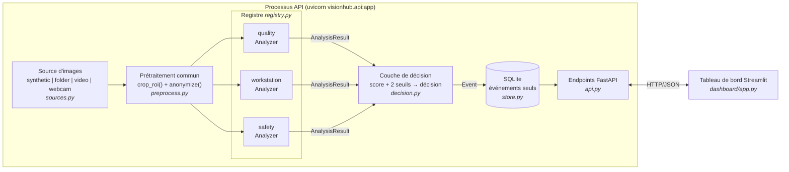

# Architecture

Un seul processus Python, sans microservice. Les trois cas d'usage sont des modules chargés par un registre et reçoivent **la même image**.

## Les étapes

| Étape | Fichier | Entrée → sortie |
|---|---|---|
| Source | `visionhub/sources.py` | configuration `SOURCE` → images BGR `uint8 (H, W, 3)` |
| Prétraitement | `visionhub/preprocess.py` | image → image recadrée (`ROI`), anonymisée si `ANONYMIZE=true` (stub pour l'instant) |
| Analyse | `usecases/<cas>/…` | `(image, FrameMeta)` → `AnalysisResult` (score brut dans [0, 1], **plus haut = plus grave**) |
| Décision | `visionhub/decision.py` | `score < bas` → `conforme` ; `bas ≤ score < haut` → `a_verifier` ; `score ≥ haut` → `anomalie` |
| Stockage | `visionhub/store.py` | `Event` → SQLite (`DB_PATH`). **Aucune image n'est stockée.** |
| API | `visionhub/api.py` | voir le tableau ci-dessous |
| Tableau de bord | `dashboard/app.py` | aucune logique métier, ne fait que des appels à l'API |

La boucle `pipeline.py` tourne dans un thread lancé au démarrage de l'API, au rythme `PIPELINE_FPS`. Le temps d'inférence (`latency_ms`) est mesuré par cette boucle, pas déclaré par l'analyseur. Les appels aux analyseurs sont sérialisés : un modèle qui ne supporte pas les appels concurrents ne pose donc pas de problème.

## Contrats (`visionhub/contracts.py`)

- `FrameMeta` : `frame_id`, `timestamp` (UTC), `workstation_id`, `camera_id`.
- `AnalysisResult` : `use_case`, `score`, `latency_ms`, `model_name`, `model_version`, `details`.
- `details` dépend du cas d'usage, discriminé par le champ `kind` : `QualityDetails`, `WorkstationDetails`, `SafetyDetails`.
- `Event` = `AnalysisResult` + `event_id`, `frame`, `decision`, `thresholds_used`, `operator_feedback`.
- Boîtes englobantes **normalisées** dans [0, 1]. Tous les modèles refusent les champs inconnus (`extra="forbid"`).
- `SafetyDetails` ne contient **aucune donnée d'identité** : seulement l'état de chaque EPI par personne.

## API

| Méthode | Route | Rôle |
|---|---|---|
| GET | `/health` | état de l'API et de la chaîne d'analyse |
| GET | `/use-cases` | analyseurs chargés : statut, version, seuils |
| GET | `/events?use_case=&decision=&pending_feedback=&limit=` | derniers événements |
| GET | `/stats` | compteurs par cas d'usage et par décision, taux de `a_verifier`, cas en attente de verdict |
| POST | `/analyze?use_case=&store=false` | analyse d'une image envoyée (multipart, champ `image`) |
| PUT | `/thresholds/{use_case}` | `{"low": 0.4, "high": 0.7}` : effet immédiat (non persisté au redémarrage) |
| POST | `/events/{event_id}/feedback` | `{"verdict": "conforme" \| "defaut", "comment": "…"}`, uniquement sur `a_verifier` |

Documentation interactive : `http://localhost:8000/docs`.

## Brancher un vrai modèle

1. Créer une classe qui hérite de `Analyzer` dans `usecases/<cas>/`.
2. Changer `analyzer_class` dans `usecases/<cas>/config.yaml`.
3. Faire passer le test de contrat.

Rien d'autre ne change. Si un analyseur ne se charge pas, son cas d'usage apparaît en erreur dans `/use-cases` et les deux autres continuent de tourner.

## Choix assumés

- **SQLite plutôt qu'un serveur de base de données** : un seul fichier, zéro installation.
- **Thread plutôt que broker de messages** : un poste, une caméra ; c'est suffisant.
- **CPU par défaut** : `DEVICE=cuda` est simplement transmis aux analyseurs dans `load()`.
- **Pas d'authentification** : les ports ne sont ouverts que sur `127.0.0.1`.
