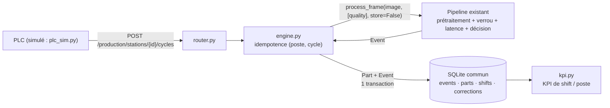

# ARGOS Production Engine (ARGOS-02A)

Couche métier industrielle, **distincte des événements d'inférence** : un événement n'est pas une pièce. Une **pièce** (`Part`) n'existe que lorsqu'un **cycle PLC** est déclenché ; elle référence l'événement d'inférence qui a produit sa prédiction.

Code : `visionhub/production/`. Point d'entrée **temporaire** : `visionhub/argos_app.py` (API historique + Production Engine), en attendant l'accord de l'équipe sur `visionhub/api.py`.



## Vocabulaire

| Notion | Signification | Qui la fixe |
|---|---|---|
| `predicted_verdict` + `prediction` | Verdict de l'IA, score, modèle et version, seuils utilisés, latence, `event_id`. **Immuable** (trigger SQLite). | IA |
| `error` | Erreur technique initiale (`ERROR`). **Jamais effacée**, même après correction. | Système |
| `effective_verdict` | Verdict courant dans ARGOS : dernière correction humaine, sinon la prédiction. | Humain / IA |
| `disposition` | Devenir physique (`UNKNOWN`, `SHIPPED`, `QUARANTINED`, `REWORKED`, `SCRAPPED`). | Processus industriel |

**Une correction dans ARGOS n'est jamais une commande de libération physique de la pièce.**

## Verdicts

| Couche de décision | Verdict industriel |
|---|---|
| `conforme` | `OK` |
| `anomalie` | `NOK` |
| `a_verifier` | `HOLD` |
| exception de l'analyseur, analyseur qualité non chargé, image illisible, cycle industriel sans image | `ERROR` (codes `ANALYZER_FAILED`, `ANALYZER_UNAVAILABLE`, `IMAGE_DECODE_FAILED`, `CAPTURE_FAILED`) |

`HOLD` et `ERROR` ne sont **jamais** comptés comme `OK` ni comme `NOK`. L'enum `Decision` n'est pas modifiée.

## Cycles et idempotence

- Clé unique : `(station_id, cycle_id)`. Un rejeu identique renvoie **200** + en-tête `Idempotent-Replay: true` **sans nouvelle inférence**. Même clé avec une autre image, caméra ou source → **409**.
- Seul l'analyseur **qualité** est exécuté, via `Pipeline.process_frame` (mêmes garanties que le socle : prétraitement, verrou d'analyse partagé avec la boucle continue, mesure de latence).
- `simulated=true` : cycle simulé (`trigger_source = plc_simulated`) ; sans image, le serveur dessine une image synthétique déterministe. `simulated=false` (défaut) : cycle industriel (`plc`) ; **sans image → ERROR `CAPTURE_FAILED`, jamais d'image synthétique de secours.**
- La pièce et son événement d'inférence sont écrits **dans une seule transaction SQLite**.

### Garanties et limites

| Situation | Comportement |
|---|---|
| Même cycle envoyé N fois (séquentiel, concurrent, après redémarrage) | 1 seule pièce, 1 seule inférence (verrou + contrainte `UNIQUE`) |
| Panne **après** l'inférence, **avant** le commit | Rien n'est écrit ; le rejeu du PLC relance l'inférence. **Inférence « au moins une fois », pièce « au plus une fois ».** L'exactement-une-fois n'est pas garanti. |
| Panne **après** le commit, réponse perdue | Le rejeu du PLC reçoit la pièce existante (200) |
| Deux processus sur la même base | Le second `INSERT` échoue sur `UNIQUE` → rejeu ; une inférence en double est alors possible |
| Compteur PLC remis à zéro | Un nouveau cycle avec un ancien identifiant serait pris pour un rejeu (ou un 409). **Les identifiants de cycle doivent être uniques par poste** (question ouverte pour Hutchinson) |

## Shifts et KPI

Un seul shift ouvert par poste (index unique partiel). Une pièce est rattachée au shift ouvert de son poste au moment du cycle (sinon `shift_id = null`). La boucle d'inférence continue **ne crée aucune pièce** : seuls les cycles comptent.

| KPI | Formule |
|---|---|
| `total_parts`, `ok_parts`, `nok_parts`, `hold_parts`, `error_parts` | nombre de pièces par **verdict effectif** |
| `predicted_*_parts` | même chose sur le verdict **prédit** |
| `yield_rate` | OK / total |
| `nok_rate` | NOK / total (**ce n'est pas un taux de rebut** : le rebut est une disposition) |
| `pending_rate` | (HOLD + ERROR) / total |
| `correction_rate` | pièces corrigées / total |
| `target_progress` | OK / objectif |
| `actual_total_rate_per_hour`, `actual_ok_rate_per_hour` | total (ou OK) / heures écoulées ; `null` sous 60 s |
| `expected_ok_rate_per_hour` | objectif / durée prévue (h) |
| `expected_ok_parts_by_now` | min(objectif, cadence attendue × heures écoulées) |
| `efficiency` | OK / `expected_ok_parts_by_now` |

Tout dénominateur nul donne `null` (absence de donnée ≠ 0 %). Horodatage UTC. Un shift fermé garde sa période (`started_at` → `ended_at`) ; une correction faite après la clôture met à jour ses compteurs, pas sa durée.

## Corrections humaines

- `POST /production/parts/{part_id}/corrections` : `new_verdict` (`OK`/`NOK`), `expected_current_verdict` (verrou optimiste → **409** si la pièce a changé), `reason` obligatoire, `actor_role` (`operator`, `supervisor`, `quality`), **aucun identifiant personnel**.
- `HOLD` et `ERROR` : correction seulement avec `physical_inspection: true`.
- Historique **append-only** (`GET .../corrections`) ; prédiction et erreur initiales intactes.
- Pas de validation superviseur imposée (règle à confirmer avec Hutchinson).

> ⚠️ **Coexistence avec le socle historique.** `POST /events/{id}/feedback` et la file « À vérifier » du dashboard Streamlit **ne modifient pas les pièces**. Les événements des cycles (`frame_id = cycle:<poste>:<cycle>`) y apparaissent, mais **ne les corrigez pas depuis le dashboard** : utilisez exclusivement `/production/parts/{id}/corrections`.

## Endpoints

| Méthode | Route | Réponse |
|---|---|---|
| POST | `/production/stations/{station_id}/cycles` (multipart : `cycle_id`, `camera_id`, `simulated`, `image`) | `Part` — 201 / 200 rejeu / 409 / 422 |
| GET | `/production/stations/{station_id}/cycles/{cycle_id}` | `Part` |
| GET | `/production/parts?station_id&shift_id&verdict&limit` | `Part[]` |
| GET | `/production/parts/{part_id}` | `Part` |
| POST | `/production/parts/{part_id}/corrections` | `Part` (201) |
| GET | `/production/parts/{part_id}/corrections` | `Correction[]` |
| PUT | `/production/parts/{part_id}/disposition` | `Part` |
| POST | `/production/stations/{station_id}/shifts` | `Shift` (201) / 409 |
| GET | `/production/stations/{station_id}/shifts/current` | `ShiftReport` |
| POST | `/production/shifts/{shift_id}/close` | `ShiftReport` |
| GET | `/production/shifts/{shift_id}` | `ShiftReport` |
| GET | `/production/shifts?station_id&limit` | `Shift[]` |
| GET | `/production/stations/{station_id}/kpi?from&to` | `ProductionKPI` (défaut : 8 dernières heures) |

Schémas JSON complets : `/docs` ou `/openapi.json`.

## Lancer

```powershell
$env:DB_PATH = "var/argos-demo.db"
.\.venv\Scripts\python.exe -m uvicorn visionhub.argos_app:app --host 127.0.0.1 --port 8000
# autre terminal : PLC simulé
.\.venv\Scripts\python.exe -m visionhub.production.plc_sim --api-url http://127.0.0.1:8000 --station WS-01 --cycles 20 --interval 1 --duplicate-rate 0.1
```

## Base de données

Même fichier SQLite que `events` (`DB_PATH`), connexion dédiée. Migrations versionnées (`schema_migrations`), **uniquement additives**. Triggers : prédiction et identité des pièces immuables, pièces non supprimables, corrections non modifiables. Avec `DB_PATH=:memory:`, la Production Engine a sa propre base en mémoire : les événements des cycles n'apparaissent alors pas dans `/events`.
