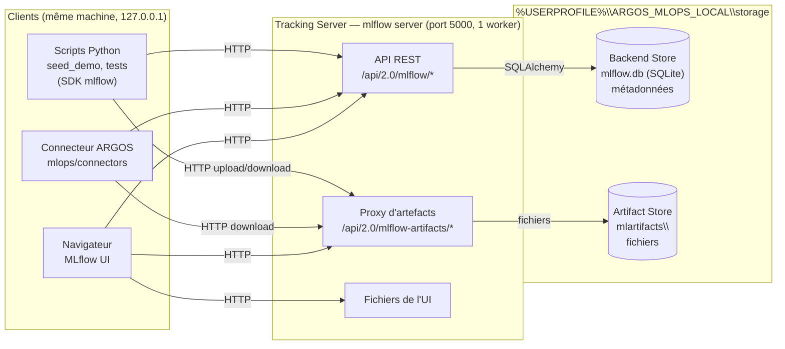
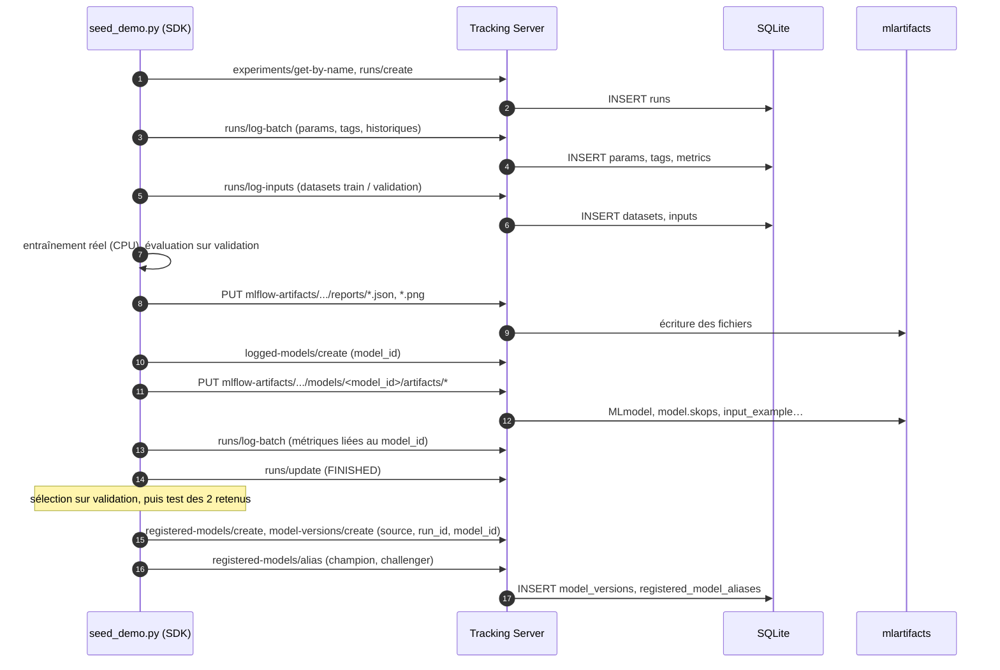
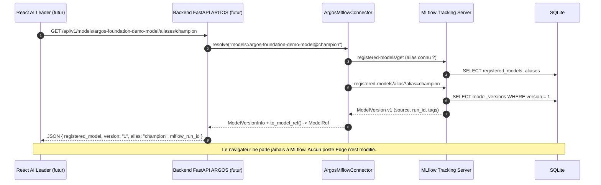

# MLOPS-01 — Comprendre la fondation MLflow d'ARGOS

Ce document explique **ce qui tourne**, **où sont les données** et **qui fait quoi**. Pour manipuler pas à pas : [exploration-guide.md](exploration-guide.md).

> Tout ce qui est décrit ici utilise des **données synthétiques** (`synthetic=true`). Aucun de ces modèles n'est un modèle industriel.

---

## 1. Architecture client-serveur

MLflow n'est pas une bibliothèque qui écrit dans des fichiers : c'est un **serveur HTTP** (le *Tracking Server*) auquel des **clients** parlent via une API REST. Les clients sont le SDK Python (`mlflow`, `MlflowClient`), l'interface web, et demain le backend ARGOS via notre connecteur.



Commande réellement lancée par `mlops/scripts/start_mlflow.ps1` :

```text
mlflow server --host 127.0.0.1 --port 5000 --workers 1
  --backend-store-uri sqlite:///C:/Users/<vous>/ARGOS_MLOPS_LOCAL/storage/mlflow.db
  --serve-artifacts
  --artifacts-destination file:///C:/Users/<vous>/ARGOS_MLOPS_LOCAL/storage/mlartifacts
```

| Option | Effet |
|---|---|
| `--host 127.0.0.1` | écoute uniquement en local : rien n'est exposé sur le réseau (vérifié par `check_mlflow.ps1`) |
| `--backend-store-uri sqlite:///…` | les métadonnées vont dans un fichier SQLite (chemin absolu : indépendant du répertoire courant) |
| `--serve-artifacts` | le serveur **relaie** les fichiers : les clients n'ont jamais besoin d'accéder au dossier |
| `--artifacts-destination file:///…` | où le serveur range physiquement les fichiers |

## 2. Le Tracking Server

Il reçoit toutes les requêtes (créer une expérience, enregistrer une métrique, enregistrer une version de modèle, télécharger un fichier), applique les règles de MLflow et délègue le stockage. Il héberge aussi le **Model Registry** (ici dans la même base : `MLFLOW_REGISTRY_URI` = `MLFLOW_TRACKING_URI`, mais les deux sont configurables séparément).

## 3. Le Backend Store (métadonnées)

`storage\mlflow.db` : une base SQLite d'environ 70 tables gérée **exclusivement** par MLflow (schéma interne, migré par Alembic à chaque version). On y trouve : `experiments`, `runs`, `params`, `metrics` (chaque point d'historique), `latest_metrics`, `tags`, `datasets`, `inputs`, `logged_models`, `registered_models`, `model_versions`, `registered_model_aliases`…

**ARGOS ne lit jamais cette base** : seul `inspect_sqlite.py` l'ouvre, en lecture seule, pour apprendre. En industriel, ce sera PostgreSQL (ou Databricks), et notre code ne changera pas.

## 4. L'Artifact Store (fichiers)

`storage\mlartifacts\` : les fichiers produits (JSON, PNG, modèles sérialisés). Structure observée :

```text
mlartifacts\
  1\                                   <- experiment_id
    <run_id>\artifacts\                <- artefacts d'un RUN
      config\config.json
      dataset\dataset_info.json
      reports\classification_report.json, confusion_matrix.json, confusion_matrix.png
    models\<model_id>\artifacts\       <- artefacts d'un LOGGED MODEL (MLflow 3)
      MLmodel, model.skops, input_example.json, requirements.txt, python_env.yaml…
```

Nouveauté MLflow 3 : le modèle n'est plus rangé « dans » le run mais dans son propre espace `models/<model_id>/`. Un run supprimé (suppression logique) garde ses fichiers jusqu'à `mlflow gc` (opération destructive, non utilisée ici).

## 5. Les URI

| URI | Signification |
|---|---|
| `http://127.0.0.1:5000` | adresse du Tracking Server (`MLFLOW_TRACKING_URI`) |
| `sqlite:///C:/…/mlflow.db` | backend store (connu du **serveur** seulement) |
| `file:///C:/…/mlartifacts` | destination physique des artefacts (connue du **serveur** seulement) |
| `mlflow-artifacts:/1/<run_id>/artifacts` | emplacement **logique** des artefacts d'un run : le client le traduit en appel HTTP au proxy |
| `runs:/<run_id>/<chemin>` | un artefact d'un run |
| `models:/<model_id>` | un **Logged Model** (ex. `models:/m-676a56ef…`) |
| `models:/argos-foundation-demo-model/1` | la **version 1** du modèle enregistré : référence **figée** |
| `models:/argos-foundation-demo-model@champion` | la version vers laquelle pointe **actuellement** l'alias `champion` : référence **mobile** |

## 6. Experiment, Run, Logged Model, Registered Model, Version, Alias

| Objet | Ce que c'est | Exemple réel | Identifiant |
|---|---|---|---|
| **Experiment** | dossier logique qui regroupe des runs comparables | `argos-foundation-demo` | `experiment_id = 1` |
| **Run** | une exécution (un entraînement) : params, métriques, tags, inputs, artefacts | `random-forest-c` | `run_id = 15c4163c…` (32 hex) |
| **Param** | entrée de configuration, écrite **une fois** (texte) | `hp_n_estimators = 300` | clé |
| **Metric** | valeur numérique ; peut avoir un **historique** (une valeur par `step`) | `val_f1_macro = 0.8113` | clé (+ step) |
| **Metric history** | toutes les valeurs d'une métrique, ordonnées par `step` | `history_val_accuracy`, step = nombre d'arbres | — |
| **Tag** | étiquette libre, modifiable (traçabilité, filtres) | `synthetic=true`, `argos.git_commit` | clé |
| **Dataset input** | jeu de données déclaré comme entrée du run, avec son contexte et son empreinte | `argos-synthetic-classification-train` (`training`) | digest |
| **Artifact** | fichier attaché au run | `reports/confusion_matrix.png` | chemin |
| **Logged Model** (MLflow 3) | modèle sérialisé **produit par** un run, avec signature, exemple et métriques liées | le RandomForest de `random-forest-c` | `model_id = m-676a56ef…` |
| **Registered Model** | nom stable dans le Registry, qui regroupe des versions | `argos-foundation-demo-model` | nom |
| **Model Version** | une entrée numérotée du Registry, qui pointe vers **un** Logged Model et garde son `run_id` | version `1` | `nom + numéro` |
| **Model Alias** | étiquette **déplaçable** pointant vers une version | `champion → 1`, `challenger → 2` | `nom@alias` |

Chaîne complète d'un modèle de la démo :

```text
Experiment 1 ─▶ Run 15c4163c… (random-forest-c) ─▶ Logged Model m-676a56ef… ─▶ Version 1 ◀─ alias champion
```

**Promotion ≠ déploiement.** Déplacer `champion` change la réponse de `models:/…@champion` dans MLflow, c'est tout. Le déploiement réel (copie d'un `model-package.json` vers un poste, approbation, rollback) relève d'ARGOS (`ModelDeployment`, chantier ultérieur) et n'a jamais lieu dans MLOPS-01.

## 7. Chemin d'une requête Python

`connector.get_run_metrics("15c4…")` :

1. `ArgosMlflowConnector` appelle `MlflowClient.get_run(run_id)` ;
2. le client construit `GET http://127.0.0.1:5000/api/2.0/mlflow/runs/get?run_id=15c4…` avec timeout et réessais (`MLFLOW_HTTP_REQUEST_*`) ;
3. le serveur lit `runs`, `params`, `latest_metrics`, `tags` dans SQLite via SQLAlchemy et répond en JSON ;
4. le client le convertit en objets `Run` ;
5. le connecteur le convertit en `RunSummary` (Pydantic, sérialisable tel quel par FastAPI), ou traduit l'erreur (`RunNotFoundError`, `ServerUnavailableError`…).



## 8. Chemin d'un artefact

À l'écriture, `mlflow.log_dict(report, "reports/classification_report.json")` sérialise le fichier en local temporaire, puis l'envoie en `PUT /api/2.0/mlflow-artifacts/artifacts/1/<run_id>/artifacts/reports/classification_report.json`. Le serveur l'écrit dans `mlartifacts\1\<run_id>\artifacts\reports\`. En base, seul l'`artifact_uri` du run est stocké (`mlflow-artifacts:/1/<run_id>/artifacts`), pas la liste des fichiers.

À la lecture, `connector.download_artifact(run_id, path)` vérifie que la destination est dans `ARGOS_MLOPS_DOWNLOAD_DIR`, puis le client demande la liste (`GET …/artifacts?path=`) et le contenu (`GET …/artifacts/<chemin>`) au proxy. Le connecteur ne touche jamais `mlartifacts`.

## 9. Lien entre une version et son entraînement

Une `ModelVersion` porte :

- `source` = `mlflow-artifacts:/1/models/m-676a56ef…/artifacts` (les fichiers du Logged Model) ;
- `run_id` = `15c4163c…` (le run qui l'a produite : params, métriques, dataset) ;
- le tag `argos.logged_model_id` = `m-676a56ef…`. Ajout ARGOS : en 3.18 OSS, le registre ne renvoie pas `model_id` à la lecture, alors on le garde explicitement.

Depuis une version, on remonte donc au run, à ses données d'entrée (dataset inputs avec empreinte), à son code (tag `argos.git_commit`) et à ses métriques.

## 10. Le connecteur ARGOS

`mlops/connectors/mlflow_client.py` → `ArgosMlflowConnector`.

| Opération | Méthode |
|---|---|
| Connexion | `ping()` (`/health`, `/version`) |
| Expériences | `list_experiments()`, `get_experiment(id_ou_nom)` |
| Runs | `list_runs(exp)`, `get_run`, `get_run_params`, `get_run_metrics`, `get_metric_history` |
| Artefacts | `list_artifacts`, `download_artifact` (dossier autorisé uniquement) |
| Registry (lecture) | `list_registered_models`, `get_registered_model`, `list_model_versions`, `get_model_version`, `resolve_alias`, `resolve("models:/…")` |
| Contrat ARGOS | `to_model_ref(version, alias)` → `visionhub.integration.mlops.ModelRef` |
| Registry (écriture de démo) | `register_demo_model`, `set_demo_alias` (refusé hors `argos-foundation-demo*`) |

Principes :

- MLflow reste la seule source de vérité (aucune base parallèle).
- Les échanges passent uniquement par REST (aucune dépendance au fichier SQLite).
- Les erreurs sont explicites (`errors.py`).
- La configuration passe par variables d'environnement (`mlops/config.py`) : tracking et registry sont séparés, avec timeout 10 s, 2 réessais et un facteur de backoff entier de 1 (MLflow 3.18 refuse les décimaux). Ces valeurs ne s'appliquent qu'au processus, jamais à Windows.
- Les retours sont des modèles Pydantic prêts pour FastAPI.



## 11. Intégration future (hors MLOPS-01)

- **FastAPI Core** : instancier un `ArgosMlflowConnector` par processus, exposer `/api/v1/models`, `/api/v1/training-jobs`… (catalogue dans `docs/integration-contracts.md`), mapper les erreurs (503, 404, 403, 502). Les réponses suivent les contrats ARGOS (`ModelRef`, `ModelPackage`, `TrainingJob`, `EvaluationMetrics`).
- **React AI Leader** : consomme uniquement l'API ARGOS (déjà typée et simulée dans `frontend/`). MLflow UI reste un outil d'expert, pas l'interface utilisateur.
- **Edge** : reçoit plus tard un `model-package.json` approuvé ; il ne dépend jamais de MLflow pour inférer.

## 12. Local (MLOPS-01) vs industriel

| Aspect | Ici | Cible industrielle |
|---|---|---|
| Backend store | SQLite, 1 fichier | PostgreSQL managé ou Databricks |
| Artifact store | dossier local servi par le serveur | stockage objet (S3, ADLS…) ou Unity Catalog Volumes |
| Réseau | 127.0.0.1, sans authentification | HTTPS, authentification (SSO / basic-auth), `--allowed-hosts`, réseau privé |
| Disponibilité | 1 processus, 1 worker | plusieurs workers ou instances, sauvegardes, supervision |
| Calcul | CPU portable, scikit-learn | cluster A100, jobs planifiés |
| Données | synthétiques | versionnées (DVC), autorisations vérifiées |
| Promotion | alias de démonstration | Evaluation Gate + approbation AI Leader + déploiement ARGOS |

## 13. Ce que fournit MLflow et ce qu'ARGOS a développé

| Brique | Fournie par MLflow | Développée par ARGOS | Rôle | Interaction |
|---|---|---|---|---|
| Tracking Server + UI | ✅ `mlflow server` | scripts start / stop / check | API REST, UI, proxy d'artefacts | reçoit SDK, connecteur, navigateur |
| Backend Store | ✅ SQLite + Alembic | choix du chemin | métadonnées | lu et écrit par le serveur seul |
| Artifact Store | ✅ proxy `--serve-artifacts` | choix du chemin | fichiers | écrit et lu via HTTP |
| Experiment Tracking | ✅ SDK `mlflow.*` | `seed_demo.py`, `mlops/demo/*` | runs, params, métriques, historiques, inputs | → serveur |
| Logged Models | ✅ `mlflow.sklearn.log_model` | signature, exemple, types de confiance skops | modèle versionnable | → Registry |
| Model Registry + Alias | ✅ | noms et tags ARGOS, tag `argos.logged_model_id` | versions et promotion | lu par le connecteur |
| Connecteur | — | ✅ `ArgosMlflowConnector` | façade REST typée et sûre | → MLflow ; ← futur FastAPI |
| Contrats | — | ✅ `ModelRef` (existant) | langage commun ARGOS | connecteur ↔ Core ↔ Frontend |
| Tests | — | ✅ unitaires + intégration | non-régression | contre mocks et serveur réel |
